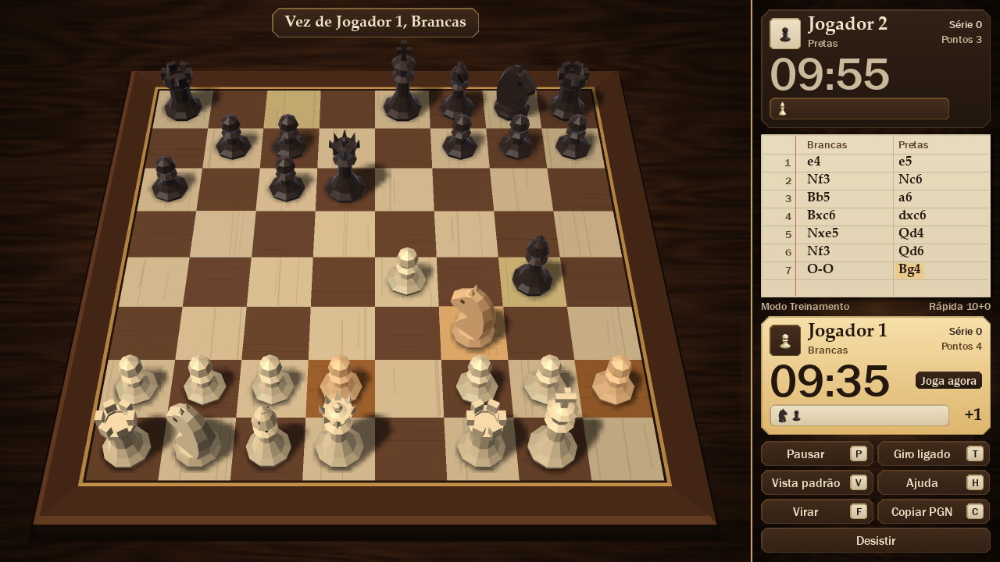

# Chess - The Game

Xadrez 3D low-poly para 2 jogadores na mesma tela, em Python. Regras oficiais completas e pipeline gráfico próprio, escrito sobre pygame e numpy: matrizes, malhas, iluminação, sombras, partículas e clique por raio estão todos no código, sem motor pronto.

Projeto da atividade A3 de Computação Gráfica e Realidade Virtual, Grupo 09.



## O que o jogo tem

- Roque, en passant, promoção, xeque, xeque-mate, afogamento e empates.
- Relógio sem limite, de 5, de 10 ou de 30 minutos, e placar da série entre partidas.
- Caminhos válidos por matriz de cores. Peças sob ameaça e rei em xeque ganham cor e forma.
- Câmera que orbita e aproxima, com clique correto em qualquer ângulo.
- Partida inteira por mouse ou por teclado.
- Modo didático (F4), que mostra as matrizes e o raio do mouse ao vivo.

## Instalação

Precisa de Python 3.10 ou mais novo. As dependências são `pygame` e `numpy`.

Baixe o código:

```
git clone https://github.com/Kauhan33/chess-the-game.git
cd chess-the-game
```

No Windows:

```
python -m venv .venv
.venv\Scripts\activate
pip install -r requirements.txt
python main.py
```

No Linux e no macOS:

```
python3 -m venv .venv
source .venv/bin/activate
pip install -r requirements.txt
python main.py
```

O CI em `.github/workflows/testes.yml` roda os testes em Python 3.10 e 3.12, no Windows, no Linux e no macOS, e todas as combinações passaram. Ele roda sem janela: o jogo só foi aberto em janela real e medido em Python 3.12 no Windows 11. O capítulo 7 traz os detalhes.

### Executável, sem instalar Python (Windows)

`tools/gerar_executavel.py` gera `dist/ChessTheGame.exe`, um arquivo único que abre o jogo em uma máquina sem Python. A pasta `dist/` não vai para o repositório, então é preciso gerar o arquivo uma vez:

```
pip install pyinstaller pillow
python tools/gerar_executavel.py
```

## Controles

| Entrada | Ação |
|---|---|
| Clique esquerdo | Seleciona a peça e joga |
| Botão direito, arrastando | Gira a câmera |
| Roda do mouse | Aproxima e afasta a câmera |
| Setas | Movem o cursor, conforme a visão |
| Enter ou Espaço | Confirma, como o clique |
| Esc | Cancela a seleção. Sem seleção, abre a pausa |
| P | Pausa a partida |
| R | Reinicia, depois de confirmar |
| T | Liga ou desliga o giro por turno |
| V | Volta à vista padrão |
| H ou F1 | Mostra a ajuda |
| F3 | Mostra FPS e polígonos |
| F4 | Modo didático |
| F11 | Liga ou desliga a tela cheia |

## Testes

```
pip install -r requirements-dev.txt
python -m pytest                  # todos, inclusive o perft profundo, que demora alguns minutos
python -m pytest -m "not slow"    # sem os testes demorados
```

Os testes rodam sem abrir janela. O resultado da última execução, com a cobertura, está em `docs/07-plano-de-testes.md`.

Para ver o jogo em janela real e medir o FPS:

```
python tools/demo_automatica.py
```

## Estrutura

```
main.py          inicia o jogo
xadrez/
  core/          regras do jogo. Python puro, sem pygame e sem numpy
  graphics/      computação gráfica. numpy e pygame, sem conhecer as regras
  ui/            cenas, HUD e entrada. Liga core e graphics
tests/           testes de core, graphics, ui e da regra de camadas
tools/           benchmarks, demonstração, geração de prints, documentação e executável
docs/            documentação, diagramas UML e imagens
```

A regra de dependência é `ui -> core` e `ui -> graphics`. `core` e `graphics` nunca se importam, e `tests/test_arquitetura.py` garante isso.

## Documentação

| Capítulo | Conteúdo |
|---|---|
| [1. Visão e requisitos](docs/01-visao-e-requisitos.md) | Escopo, regras, público-alvo, RF e RNF |
| [2. Protótipos de tela](docs/02-prototipos-ui-ux.md) | Wireframes, prints e justificativa gráfica |
| [3. Casos de uso](docs/03-casos-de-uso.md) | Diagrama e especificação dos fluxos |
| [4. Modelagem UML](docs/04-modelagem-uml.md) | Diagramas de classes, sequência e estados |
| [5. Arquitetura](docs/05-arquitetura.md) | Camadas, decisões e motivos |
| [6. Computação gráfica](docs/06-computacao-grafica.md) | Cada conceito: fórmula, código e como mostrar no jogo |
| [7. Plano de testes](docs/07-plano-de-testes.md) | Casos de teste, resultados reais, cobertura e RNF |
| [8. Matriz de rastreabilidade](docs/08-matriz-rastreabilidade.md) | RF, UC e CT cruzados |
| [9. Kanban](docs/09-kanban.md) | Tarefas e evolução real pelo git |
| [10. Roteiro da apresentação](docs/10-roteiro-apresentacao.md) | Divisão da fala, demonstração lance a lance e perguntas prováveis |
| [11. Guia de estudo](docs/11-guia-de-estudo.md) | O que cada integrante precisa ler e explicar, com experimentos testados |

### Gerar a documentação de novo

```
python tools/gerar_documentacao.py
```

Refaz, em ordem, os prints, os wireframes, os diagramas, os testes, a matriz e os PDFs. Tudo o que é resultado sai da execução real. Precisa de:

- Java e `tools/.cache/plantuml.jar`, para os diagramas ([PlantUML](https://github.com/plantuml/plantuml/releases));
- Chrome ou Edge, para os PDFs.

Os PDFs ficam em `entrega/`, que não vai para o repositório. A capa com os dados do grupo é lida de `entrega/dados_capa.json`. Sem esse arquivo, sai uma capa genérica.
