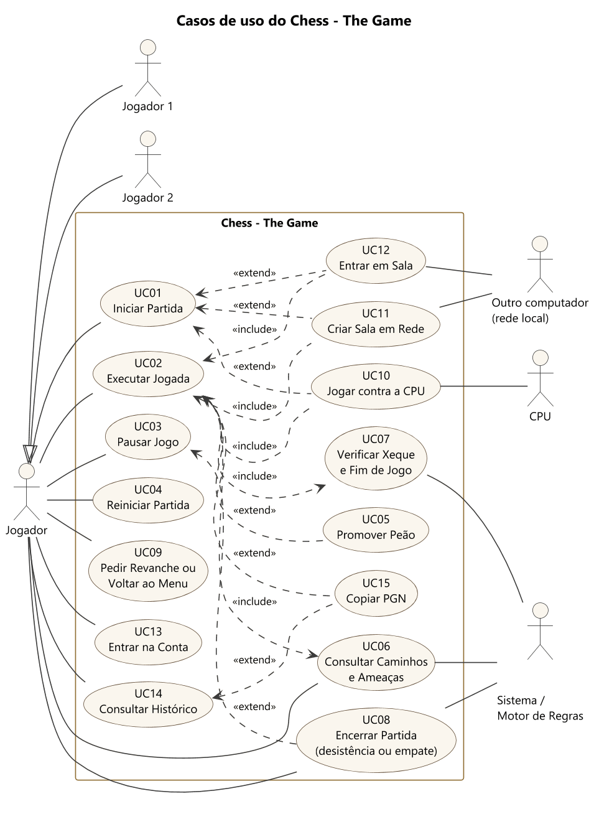

# 3. Casos de uso

## 3.1 Diagrama

**Atores.** Jogador 1 e Jogador 2 são especializações de Jogador: qualquer um deles faz as mesmas ações, cada um na sua vez. O Sistema / Motor de Regras é o ator que decide o que é legal e quando a partida termina. A CPU joga contra quem está na tela. Outro computador é quem está do outro lado da sala em rede.

**Relacionamentos.**

- UC02 inclui UC06: toda jogada passa pela seleção, que calcula e mostra os caminhos.
- UC02 inclui UC07: todo lance aceito é seguido da verificação de xeque e de fim de jogo.
- UC05 estende UC02: só acontece quando o peão chega à última fileira.
- UC08 estende UC03: desistir e propor empate são opções da tela de pausa.
- UC10, UC11 e UC12 estendem UC01 e incluem UC02: a partida contra a CPU e a partida em rede começam pelo mesmo menu e usam a mesma jogada.
- UC15 estende UC02 e UC14: o PGN pode ser copiado na partida, na tela de fim e no histórico.

As mensagens entre aspas nos fluxos abaixo são os textos reais do jogo.

## 3.2 Especificação

### UC01 Iniciar Partida

| | |
|---|---|
| **Atores** | Jogador 1, Jogador 2 |
| **Pré-condição** | O jogo está aberto no menu inicial. |
| **Pós-condição** | Há uma partida em andamento, com as brancas na vez e o relógio correndo. |

**Fluxo principal**

1. O sistema mostra a aba "Jogar", com "2 jogadores" em "Adversário" e "Treinamento" em "Modo", os campos "Brancas" e "Pretas", os seletores "Tempo por jogador" e "Câmera" e o botão "Iniciar partida".
2. Os jogadores escolhem o modo: "Treinamento" ou "Partida".
3. Os jogadores digitam os nomes, de até 16 caracteres.
4. Os jogadores escolhem o tempo: "Sem limite", "Blitz 3+2", "Blitz 5", "Rápida 10+0", "Clássica 30" ou "Clássica 15+10".
5. Os jogadores escolhem a câmera: "Gira a cada turno" ou "Fixa no lado das Brancas".
6. Um dos jogadores aciona "Iniciar partida".
7. O sistema cria o motor com essas opções, monta o tabuleiro na posição oficial e mostra a partida.

**Fluxos alternativos**

- **A1, só teclado:** Tab e as setas verticais movem o foco. As setas laterais trocam a opção do seletor. Enter avança e, no botão, inicia a partida.
- **A2, nome vazio:** o campo vazio, ou só com espaços, vira "Jogador 1" ou "Jogador 2".
- **A3, ajuda:** "Ver todos os controles" ou F1 abre a lista de controles sobre o menu.
- **A4, sair:** o botão "Sair" encerra o jogo.
- **A5, outro adversário:** "Contra a CPU" segue em UC10, e "Rede local", em UC11 ou UC12.
- **A6, quem está na conta:** o primeiro campo já vem com o nome da conta (UC13).

**Fluxo de exceção**

- **E1, caractere que a fonte não desenha:** o caractere é ignorado e o nome continua sendo digitado.

### UC02 Executar Jogada

| | |
|---|---|
| **Atores** | Jogador da vez, Motor de Regras |
| **Pré-condição** | Partida em andamento, sem peça no ar e sem sobreposição aberta. |
| **Pós-condição** | A peça está na casa de destino, o lance está na planilha e a vez e o relógio passaram ao adversário. |

**Fluxo principal**

1. O jogador clica em uma peça da sua cor.
2. O sistema seleciona a peça, levanta o modelo e mostra os caminhos (UC06).
3. O jogador clica em uma casa de destino válida.
4. O motor valida a jogada e a executa.
5. O sistema anima o voo da peça, soma as capturas ao painel e anota o lance em SAN na planilha.
6. O motor verifica xeque e fim de jogo (UC07).
7. Quando a peça pousa, a placa do adversário acende e a faixa mostra "Vez de Jogador 2, Pretas". Com o giro ligado, a câmera vai para o lado dele.

**Fluxos alternativos**

- **A1, teclado:** as setas movem o cursor, e Enter ou Espaço fazem o papel do clique.
- **A2, trocar de peça:** clicar em outra peça da própria cor troca a seleção.
- **A3, cancelar:** clicar de novo na peça selecionada, clicar fora do tabuleiro ou apertar Esc limpa a seleção.
- **A4, roque e en passant:** a torre também voa no roque. No en passant, a captura é marcada na casa vazia de destino.
- **A5, promoção:** o peão chega à última fileira e o sistema abre o diálogo (UC05).
- **A6, peça sem jogada:** a peça é selecionada e a faixa mostra "Essa peça não tem jogada válida agora.". No modo Partida, a peça é selecionada e nada é avisado.
- **A7, arrastar:** o jogador aperta em peça própria e, passando de 6 pixels, a peça sobe e segue o mouse. Soltar em destino válido joga, soltar na própria casa mantém a seleção, e soltar fora do tabuleiro só devolve.
- **A8, virar o tabuleiro:** F ou "Virar" dá meia volta na câmera, e os cliques continuam certos.

**Fluxos de exceção**

Em todos eles, a faixa mostra a mensagem por 3 s, a casa treme, a seleção é limpa e o estado da partida não muda. No modo Partida, a mensagem é sempre "Lance inválido.", sem tremor.

- **E1, tentativa fora do turno:** clique em peça do adversário sem seleção. Mensagem: "Essa peça é do adversário.".
- **E2, casa vazia sem seleção:** "Não há peça nessa casa.".
- **E3, jogada inválida:** a casa não está no padrão da peça. Mensagem: "Essa peça não pode fazer esse movimento.".
- **E4, jogada que expõe o rei:** "Essa jogada deixa o seu rei em xeque.".
- **E5, clique com a peça no ar:** o clique é ignorado até o pouso. O cursor e o relógio continuam.

### UC03 Pausar Jogo

| | |
|---|---|
| **Atores** | Jogador 1, Jogador 2 |
| **Pré-condição** | Partida em andamento, sem animação de fim de jogo. |
| **Pós-condição** | A partida volta ao estado anterior, com o relógio correndo de onde parou. |

**Fluxo principal**

1. O jogador aperta P, ou Esc sem peça selecionada, ou o botão "Pausar".
2. O sistema congela o relógio e as animações, escurece a mesa e mostra "Partida pausada" e "O relógio está parado.".
3. O jogador escolhe "Retomar", ou aperta P ou Esc.
4. O sistema fecha a sobreposição e devolve o relógio e o tabuleiro.

**Fluxos alternativos**

- **A1, opções da pausa:** "Reiniciar partida" (UC04), "Propor empate" e "Desistir" (UC08) e "Voltar ao menu" (UC09).
- **A2, painéis:** F3 e F4 continuam funcionando com a pausa aberta.

**Fluxos de exceção**

- **E1, tentativa de jogar:** cliques no tabuleiro e no painel, setas e atalhos não têm efeito enquanto a pausa está aberta.
- **E2, partida encerrada:** depois do fim do jogo, a pausa não abre.

### UC04 Reiniciar Partida

| | |
|---|---|
| **Atores** | Jogador 1, Jogador 2 |
| **Pré-condição** | Partida em andamento ou pausada. |
| **Pós-condição** | Tabuleiro na posição inicial, com as mesmas cores, relógios de volta ao tempo inicial e placar da série mantido. A partida abandonada não dá pontos. |

**Fluxo principal**

1. O jogador aperta R, ou escolhe "Reiniciar partida" na pausa.
2. O sistema pergunta "Reiniciar a partida?", com "O tabuleiro volta ao início." e "O placar da série é mantido.".
3. O jogador confirma em "Reiniciar".
4. O sistema reinicia o motor, limpa as animações e volta à vista padrão.

**Fluxo alternativo**

- **A1, desistir de reiniciar:** o foco começa na opção segura, "Voltar". Com ela, ou com Esc, nada muda.

**Fluxo de exceção**

- **E1, durante a animação de fim:** a tecla R não tem efeito.

### UC05 Promover Peão

| | |
|---|---|
| **Atores** | Jogador da vez, Motor de Regras |
| **Pré-condição** | A peça selecionada é um peão e o destino válido está na última fileira. Estende UC02. |
| **Pós-condição** | O peão sai e a peça escolhida nasce na casa de destino, com animação. |

**Fluxo principal**

1. O sistema abre o diálogo "Promoção do peão", com "Escolha a peça. Esc cancela o lance.".
2. O jogador escolhe "Dama", "Torre", "Bispo" ou "Cavalo".
3. O motor executa a jogada com a peça escolhida.
4. A peça voa e a nova peça nasce crescendo, com partículas.

**Fluxos alternativos**

- **A1, teclado:** as setas laterais e Enter escolhem, e as teclas 1 a 4 escolhem direto.
- **A2, cancelar:** Esc fecha o diálogo sem jogar e limpa a seleção.

**Fluxos de exceção**

- **E1, peão cravado:** o destino nem aparece como válido. Tentar a casa dá "Essa jogada deixa o seu rei em xeque." e o diálogo não abre.
- **E2, tempo esgotado na escolha:** o relógio segue correndo no diálogo. Se o tempo acabar, o diálogo fecha e a partida termina.

### UC06 Consultar Caminhos e Ameaças

| | |
|---|---|
| **Atores** | Jogador da vez, Motor de Regras |
| **Pré-condição** | Partida em andamento, em modo Treinamento. |
| **Pós-condição** | A matriz de cores mostra o estado atual. A partida não muda. |

**Fluxo principal**

1. No início do turno, o motor calcula quais peças de quem joga estão ameaçadas e se há xeque.
2. O sistema marca as peças ameaçadas com cor de ameaça, triângulo e tint pulsante.
3. O jogador seleciona uma peça da sua cor.
4. O motor devolve as jogadas legais dela.
5. O sistema marca a origem em amarelo com cantos, os caminhos em verde com ponto e as capturas em vermelho com anel.

**Fluxos alternativos**

- **A1, xeque:** o rei fica vermelho, os atacantes ganham cantos e a faixa mostra "Xeque! Jogador 1 precisa defender o rei.".
- **A2, cursor:** a casa sob o mouse ou o cursor do teclado fica azul com cantos, exceto a selecionada.
- **A3, modo didático:** F4 mostra a matriz de estados em números, ao lado do tabuleiro.
- **A4, girar a câmera:** o jogador orbita ou aproxima a câmera para ver melhor, e os cliques continuam certos.
- **A5, modo Partida:** nada disso é calculado nem mostrado. Ficam só a peça selecionada, o cursor e o último lance, inclusive no painel F4.

**Fluxo de exceção**

- **E1, peça do adversário:** o motor não devolve jogadas fora do turno. O fluxo segue a exceção E1 do UC02.

### UC07 Verificar Xeque e Fim de Jogo

| | |
|---|---|
| **Atores** | Motor de Regras |
| **Pré-condição** | Um lance acabou de ser aceito, ou o relógio avançou. Incluído em UC02. |
| **Pós-condição** | A partida continua com o estado de xeque atualizado, ou está encerrada com resultado. |

**Fluxo principal**

1. O motor verifica se o lado da vez tem alguma jogada legal.
2. Se tem, verifica material insuficiente, tripla repetição e regra dos 50 lances, nessa ordem.
3. Nenhuma condição vale. A partida continua e o sistema atualiza os alertas no início do turno.

**Fluxos alternativos**

- **A1, xeque-mate:** sem jogadas e em xeque. O adversário vence, a faixa mostra "Xeque-mate! Jogador 1 venceu.", o rei tomba e há fogos por 2,2 s antes da tela final.
- **A2, afogamento ou empate automático:** sem vencedor, com 0,5 ponto para cada. A faixa mostra, por exemplo, "Empate: Afogamento". A tela final vem em 0,9 s.
- **A3, tempo esgotado:** a cada quadro, `tick` confere o relógio de quem joga. Quem zerou perde, salvo se o adversário só tiver o rei, caso em que é empate.

**Fluxo de exceção**

- **E1, lance depois do fim:** o motor responde "A partida não está ativa." e nada muda.

### UC08 Encerrar Partida

| | |
|---|---|
| **Atores** | Jogador 1, Jogador 2, Motor de Regras |
| **Pré-condição** | A pausa está aberta. Estende UC03. |
| **Pós-condição** | A partida está encerrada, com os pontos somados à série, e a tela final aparece. |

**Fluxo principal: desistência**

1. O jogador da vez escolhe "Desistir" na pausa.
2. O sistema pergunta "Desistir da partida?", com "Jogador 1 entrega a partida." e "A vitória vai para Jogador 2.".
3. O jogador confirma em "Desistir".
4. O motor registra a vitória do adversário por desistência.

**Fluxo alternativo: empate por acordo**

1. O jogador da vez escolhe "Propor empate".
2. O sistema mostra "Proposta de empate", com "Jogador 1 propõe empate." e "Jogador 2, você aceita?".
3. O outro jogador escolhe "Aceitar empate".
4. O motor registra o empate, com 0,5 ponto para cada.

**Fluxos de exceção**

- **E1, empate recusado:** "Recusar", ou Esc, fecha tudo, e a faixa mostra "Jogador 2 recusou o empate.". A partida segue.
- **E2, desistência cancelada:** "Voltar", ou Esc, retorna à pausa. O foco já começa nessa opção.

### UC09 Pedir Revanche ou Voltar ao Menu

| | |
|---|---|
| **Atores** | Jogador 1, Jogador 2 |
| **Pré-condição** | A tela de fim de jogo está aberta. Para voltar ao menu, a pausa também serve. |
| **Pós-condição** | Nova partida com o placar mantido, ou menu com os nomes lembrados e uma série nova. |

**Fluxo principal: revanche**

1. O sistema mostra o resultado, o vencedor, o motivo, o número de lances e o placar da série.
2. O jogador escolhe "Revanche com cores trocadas".
3. O motor inverte as cores e começa outra partida, com o mesmo placar.
4. O sistema limpa as animações e volta à vista padrão.

**Fluxo alternativo: voltar ao menu**

1. O jogador escolhe "Voltar ao menu".
2. O sistema mostra o menu, com os nomes e as opções da partida anterior.
3. A próxima partida cria um motor novo, com o placar zerado.

**Fluxo de exceção**

- **E1, voltar ao menu pela pausa:** o sistema pergunta "Voltar ao menu?", com "A partida é abandonada e o placar" e "da série começa de novo.". "Voltar" ou Esc cancela.

### UC10 Jogar contra a CPU

| | |
|---|---|
| **Atores** | Jogador, CPU, Motor de Regras |
| **Pré-condição** | O jogo está aberto no menu, na aba "Jogar". Estende UC01 e inclui UC02. |
| **Pós-condição** | A partida terminou na tela de fim, ou foi abandonada. Se há conta, a partida encerrada está no histórico, com o nível. |

**Fluxo principal**

1. O jogador escolhe "Contra a CPU" em "Adversário".
2. O sistema mostra "Nível" (Easy, Medium, Hard ou Hardcore), com a frase que explica o nível, "Sua cor" (Brancas, Pretas ou Sorteio) e "Tempo por jogador".
3. O jogador escolhe o modo, o nível, a cor e o tempo e aciona "Iniciar partida".
4. O sistema mostra a partida, com a câmera do lado do jogador.
5. O jogador faz o lance (UC02).
6. Quando a peça pousa, a placa da CPU acende com a etiqueta "Pensando", e a faixa mostra "CPU (Hard) está pensando".
7. A busca roda em outra thread, sobre uma cópia do tabuleiro. A tela continua respondendo.
8. A jogada volta, o motor a valida e o sistema anima o voo. Os passos 5 a 8 se repetem até o fim (UC07).

**Fluxos alternativos**

- **A1, CPU de brancas:** ela joga primeiro, e a câmera fica do lado do jogador.
- **A2, sorteio:** o sistema escolhe a cor ao iniciar, e o menu continua lembrando o sorteio.
- **A3, revanche:** as cores trocam, e a CPU pode abrir a partida.
- **A4, virar:** F ou "Virar" dá meia volta. Sem giro por turno, a virada fica até "Vista padrão".
- **A5, modo Partida:** nenhuma dica aparece, como em UC02 e UC06.

**Fluxos de exceção**

- **E1, clique na vez da CPU:** a faixa mostra "Aguarde: é a vez da CPU." e nada muda.
- **E2, pausa, reinício, desistência, menu ou janela fechada com a CPU pensando:** a busca é cancelada. Com a pausa, ela segue, e a jogada só entra depois de retomar. Nada chega depois de cancelar, e nenhuma thread sobra.
- **E3, tempo esgotado na busca:** o limite da busca é sempre menor que o tempo que resta. Se o relógio acabar assim mesmo, a jogada não entra e a partida termina.
- **E4, falha na busca:** a CPU faz um lance legal qualquer, e a faixa mostra "A busca da CPU falhou, e ela fez um lance simples para a partida seguir.".
- **E5, propor empate:** a opção não existe contra a CPU.

### UC11 Criar Sala em Rede

| | |
|---|---|
| **Atores** | Jogador que cria a sala, Outro computador, Motor de Regras |
| **Pré-condição** | O jogo foi aberto pelo `main.py` ou pelo executável, e o jogador escolheu "Rede local". Estende UC01 e inclui UC02. |
| **Pós-condição** | Os dois lados terminaram a partida com o mesmo FEN e o mesmo resultado, ou a sala foi fechada. A porta não fica aberta depois da sessão. |

**Fluxo principal**

1. O jogador digita o próprio nome, se não estiver em uma conta, escolhe o modo e o tempo e aciona "Criar sala".
2. O sistema abre a porta 50507 e mostra o código de 7 caracteres, "Passe este código para quem vai jogar com você." e "Aguardando adversário".
3. O jogador passa o código ao outro, ditando ou por "Copiar convite".
4. Quem entra na sala conecta (UC12), e a sala valida o `hello`.
5. A sala responde com `start`, e a partida abre nos dois computadores. Quem criou joga de brancas na primeira partida.
6. A cada lance recebido, a sala valida no próprio motor, mede os dois relógios e anima o voo.
7. Quando a partida acaba, a sala manda `result`, com vencedor, motivo e em que lance parou, e abre a tela de fim.

**Fluxos alternativos**

- **A1, sem rede local:** a tela avisa "Sem rede local: esta sala só pode ser acessada neste computador. Conecte-se a uma rede e crie outra.".
- **A2, revanche:** com os dois pedidos, a sala manda um novo `start`, com as cores trocadas. Ela continua a autoridade, mesmo de pretas.
- **A3, proposta de empate:** em "Opções", "Propor empate" envia a proposta, uma por lance. A faixa avisa a recusa.
- **A4, cancelar:** "Cancelar e voltar" ou Esc fecha a sala antes de o outro entrar.

**Fluxos de exceção**

- **E1, porta ocupada:** a tela mostra "Não foi possível abrir a porta 50507: ela está ocupada ou bloqueada. Feche o outro jogo ou sala e tente de novo." e oferece "Abrir a sala de novo".
- **E2, segundo jogador:** quem tenta entrar em sala cheia é recusado, e a partida segue.
- **E3, lance ilegal ou fora da vez, vindo do outro lado:** a sala encerra com a vitória de quem ficou, e a tela de fim explica "O adversário enviou uma jogada ilegal, e a sala foi encerrada.".
- **E4, mensagem inválida:** a conexão cai, com "O outro lado enviou dados inválidos, e a conexão foi encerrada.".
- **E5, queda ou 8 s sem resposta:** a partida termina por abandono do outro, com o aviso na tela de fim.
- **E6, sair da sala:** o sistema pergunta "Sair da sala?", com "Sair da sala conta como abandono:" e "a vitória vai para o adversário.". Fechar a janela tem o mesmo efeito, e a derrota é gravada antes de a conexão fechar.

### UC12 Entrar em Sala

| | |
|---|---|
| **Atores** | Jogador que entra, Outro computador, Motor de Regras |
| **Pré-condição** | Outro jogador criou a sala (UC11), e os dois estão na mesma rede local. Estende UC01 e inclui UC02. |
| **Pós-condição** | A partida terminou com o `result` da sala, e só então entrou no histórico da conta. |

**Fluxo principal**

1. O jogador escolhe "Rede local", digita o nome, se não estiver em uma conta, e aciona "Entrar com código".
2. O sistema pede o "Código da sala".
3. O jogador digita o código. Minúsculas e espaços valem.
4. O jogador aciona "Entrar na sala", ou aperta Enter, e o sistema mostra "Conectando".
5. A sala responde, e a partida abre com o tempo que ela escolheu, com o jogador de pretas na primeira partida.
6. O jogador joga sem esperar: o lance vale na hora, no motor local, e segue para a sala.
7. A partida acaba quando chega o `result` da sala. O jogador lê a tela de fim, e a partida é gravada.

**Fluxos alternativos**

- **A1, mate no próprio lance:** o mate sai na tela na hora, mas a tela de fim só abre depois do `result`.
- **A2, desistir ou aceitar empate:** é um pedido. A faixa mostra "Desistência enviada.", e o tabuleiro fica parado até a sala responder.
- **A3, proposta recebida:** o cartão aparece sobre a planilha. A aceita, Esc recusa, e jogar um lance também recusa.
- **A4, lance que cruzou com o fim:** a sala não o viu. O lance é desfeito, inclusive a captura e o ponto na série.

**Fluxos de exceção**

- **E1, código errado:** "O código da sala tem 7 caracteres.", "Código de sala inválido: ele só usa letras e números, sem 0, O, 1, I e L." ou "Código de sala inválido. Confira se foi digitado certo.". O campo continua funcionando.
- **E2, fora da rede local:** "Esse código aponta para fora da rede local. Confira o que foi digitado.". Nem tenta conectar.
- **E3, sala não encontrada:** "Não foi possível conectar à sala. Confira o código, a rede e o firewall de quem criou a sala." ou "A sala não respondeu. Confira o código, a rede e o firewall de quem criou a sala.".
- **E4, sala cheia ou versão diferente:** "Sala cheia: já há uma partida em andamento nessa sala." ou "Os dois jogadores estão com versões diferentes do jogo. Atualize para a mesma versão.".
- **E5, `result` que não confere:** "A sala enviou um resultado que não confere, e a partida foi encerrada.".
- **E6, a sala sumiu antes de decidir:** vale o que este lado já sabia: o fim no tabuleiro, o próprio pedido ou o abandono da sala. Com a sala viva e muda, a espera termina em 5 s, com "A sala não confirmou o resultado, e a conexão foi encerrada.".

### UC13 Entrar na Conta

| | |
|---|---|
| **Atores** | Jogador |
| **Pré-condição** | O jogo foi aberto pelo `main.py` ou pelo executável, e a tela de entrada está aberta. |
| **Pós-condição** | O menu mostra "Jogando como" e o nome da conta, e as partidas encerradas entram no histórico. Ou o jogador segue como convidado, sem gravar nada. |

**Fluxo principal**

1. O sistema mostra "Usuário", "Senha" e os botões "Entrar", "Jogar como convidado" e "Sair do jogo".
2. O jogador digita o usuário e a senha, que aparece como pontos.
3. O jogador aciona "Entrar", ou aperta Enter na senha.
4. O sistema confere o hash da senha, limpa o campo e mostra o menu.

**Fluxos alternativos**

- **A1, criar conta:** "Criar conta" acrescenta "Repita a senha". O usuário tem de 3 a 16 caracteres, e a senha tem pelo menos 8. O sistema grava o sal e o hash, nunca a senha, e já entra na conta.
- **A2, convidado:** "Jogar como convidado" abre o menu, com "Jogando como convidado, sem histórico".
- **A3, outra grafia:** maiúsculas e formas Unicode diferentes são a mesma conta, e o menu mostra o nome como foi criado.
- **A4, sair da conta:** "Sair da conta", no menu, volta para esta tela.
- **A5, só teclado:** Tab percorre os campos. Enter em "Usuário" vai para "Senha". Ao criar conta, Enter em "Senha" vai para "Repita a senha".

**Fluxos de exceção**

- **E1, senha errada ou conta inexistente:** a mesma mensagem, "Usuário ou senha incorretos.". As senhas são limpas, e o foco volta para "Senha".
- **E2, senhas diferentes:** "As duas senhas não são iguais. Digite de novo.".
- **E3, conta inválida:** "O nome precisa ter de 3 a 16 caracteres.", "A senha precisa ter pelo menos 8 caracteres." ou "Já existe uma conta com esse nome.".
- **E4, pasta sem permissão:** "Não foi possível gravar na pasta de dados do jogo. Verifique o espaço livre e a permissão da pasta.". O convidado continua disponível.
- **E5, arquivo de contas corrompido:** o arquivo é guardado com outro nome, e a lista começa vazia. O jogo não cai.

### UC14 Consultar Histórico

| | |
|---|---|
| **Atores** | Jogador em uma conta |
| **Pré-condição** | O menu está aberto. Só quem entrou em uma conta tem histórico (UC13). |
| **Pós-condição** | O histórico não muda: a consulta só lê. |

**Fluxo principal**

1. O jogador abre a aba "Meu histórico".
2. O sistema mostra as estatísticas ("Partidas", "Vitórias", "Derrotas" e "Empates") e a lista das últimas 50 partidas, da mais recente para a mais antiga.
3. O jogador clica em uma partida, ou aperta Enter nela.
4. O sistema abre a folha da partida sobre a mesa: resultado, motivo, data, tempo, modo, cor, lances, duração, a partida em SAN e a posição final em FEN.
5. O jogador fecha com "Fechar" ou Esc.

**Fluxos alternativos**

- **A1, teclado:** as setas, Page Up e Page Down andam na lista. Esc sem folha aberta volta à aba "Jogar".
- **A2, roda do mouse:** rola o que está sob o mouse, a lista ou os lances da folha.
- **A3, copiar:** "Copiar PGN" ou a tecla C na folha (UC15).
- **A4, nada guardado:** "Nenhuma partida guardada ainda." e "Termine uma partida e ela aparece aqui.".

**Fluxos de exceção**

- **E1, convidado:** "O histórico é só de quem tem conta.", com o botão "Criar conta".
- **E2, arquivo corrompido ou editado à mão:** o arquivo ruim é guardado com outro nome e a lista começa vazia, ou o campo fora do limite é cortado. A aba abre.
- **E3, falha ao gravar ao fim da partida:** a tela de fim avisa "A partida não entrou no histórico: não foi possível gravar neste computador.".

### UC15 Copiar PGN

| | |
|---|---|
| **Atores** | Jogador |
| **Pré-condição** | Uma partida está aberta, a tela de fim está aberta ou há uma folha aberta no histórico. Estende UC02 e UC14. |
| **Pós-condição** | O PGN está na área de transferência, ou a tela avisou que não deu. A partida não muda. |

**Fluxo principal**

1. O jogador aciona "Copiar PGN" ou aperta C.
2. O sistema monta o PGN, com os cabeçalhos, os lances numerados e o resultado.
3. O sistema entrega o texto à área de transferência e mostra "PGN copiado para a área de transferência.".

**Fluxos alternativos**

- **A1, modo Partida com a partida correndo:** o texto sai sem `+` e `#` nos lances, para não entregar o xeque que a tela esconde. O cabeçalho fica como está.
- **A2, partida em andamento:** o resultado sai como `*`.
- **A3, sem lances:** o PGN sai válido, só com cabeçalhos e resultado.
- **A4, na folha do histórico:** copia o PGN gravado, sempre com a notação completa, e a folha mostra "PGN copiado.".

**Fluxo de exceção**

- **E1, área de transferência indisponível:** a faixa mostra "Não foi possível copiar para a área de transferência neste computador.". O jogo segue.
