# 4. Modelagem UML

Os diagramas foram escritos em PlantUML. As fontes estão em `docs/uml/` e as imagens são geradas por `tools/gerar_uml.py`. Antes de desenhar, esse script lê o código com `ast` e confere se toda classe, atributo e método citado em um diagrama de classes existe em `xadrez/`. Se o código mudar e o diagrama ficar para trás, a geração para com a lista do que divergiu.

**Como ler os diagramas de classes.**

- `+` é público e `-` é privado (nome com sublinhado no início, em Python).
- Sublinhado é membro de classe. Itálico é abstrato.
- Triângulo vazado é herança. Losango cheio é composição: o todo cria e controla a parte. Losango vazado é agregação: a parte vem de fora ou é compartilhada. Linha simples é associação. Seta tracejada é dependência.
- O número na ponta da linha é a multiplicidade.
- O círculo com letra no título é a marca do PlantUML para o tipo: C é classe, A é abstrata e E é enumeração.
- «module» marca um arquivo Python só de funções (`rules.py`, `notation.py`, `matrix.py`). Não é uma classe: aparece porque as classes dependem dele. «frozen» marca uma dataclass imutável, e «NamedTuple», uma tupla com nomes.
- Os membros privados de apoio foram omitidos quando não ajudam a entender a classe. Tudo o que aparece existe no código.

## 4.1 Visão geral

As seis classes pedidas no enunciado estão aqui: `GameEngine`, `Board`, `Piece`, `Player`, `Vector2D` e `ParticleSystem`. A `GameScene` é o ponto de ligação: conversa com o motor por um lado e com a apresentação 3D pelo outro. As camadas `core` e `graphics` não se conhecem.

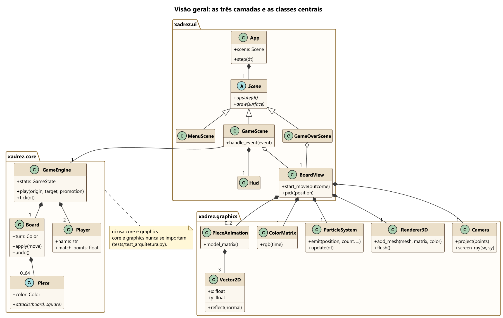

## 4.2 Camada core

### GameEngine e colaboradores

`GameEngine` é a fachada que a interface usa. É dona do `Board`, dos 2 `Player` e do `ChessClock`. O método `play` nunca levanta exceção por causa de entrada inválida: devolve um `MoveOutcome`, com o erro em `MoveError` ou com o relatório da jogada. É esse relatório que a interface usa para animar.

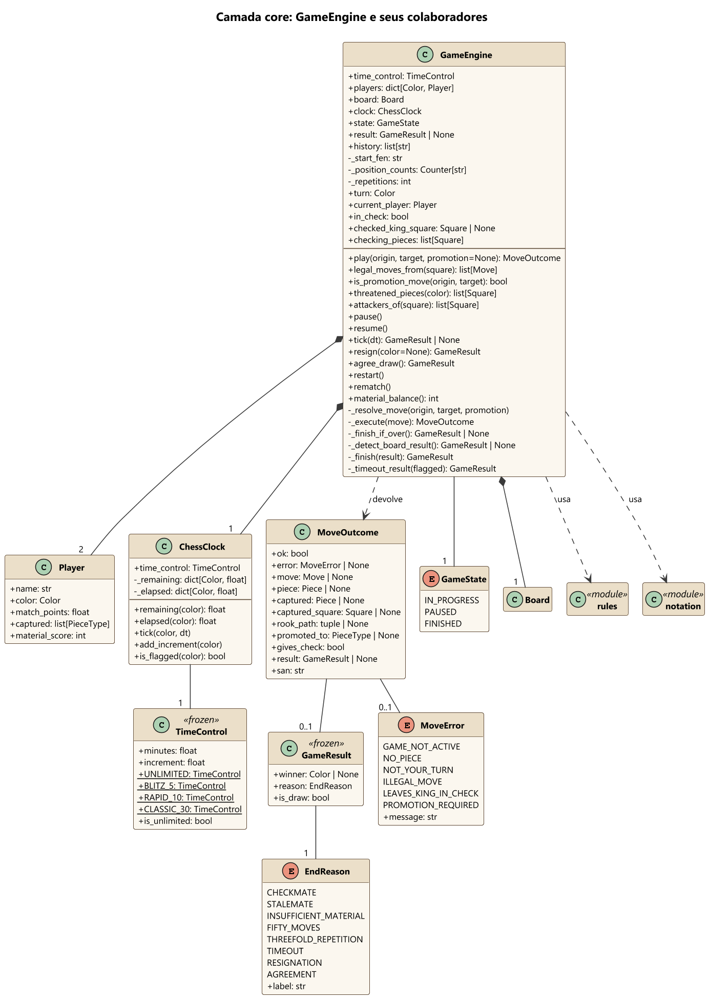

### Board, jogadas e regras de posição

`Board` guarda a posição e executa o que recebe: não decide se a jogada é legal. Quem decide é `rules.py`, que aplica a jogada com `apply`, olha se o rei ficou atacado e desfaz com `undo`. A pilha de `AppliedMove` guarda o necessário para desfazer sem copiar o tabuleiro.

`Piece` é composição de `Board` com multiplicidade 0..64 porque a grade tem 64 casas e o tabuleiro pode nascer vazio. Em uma partida real, são no máximo 32 peças.

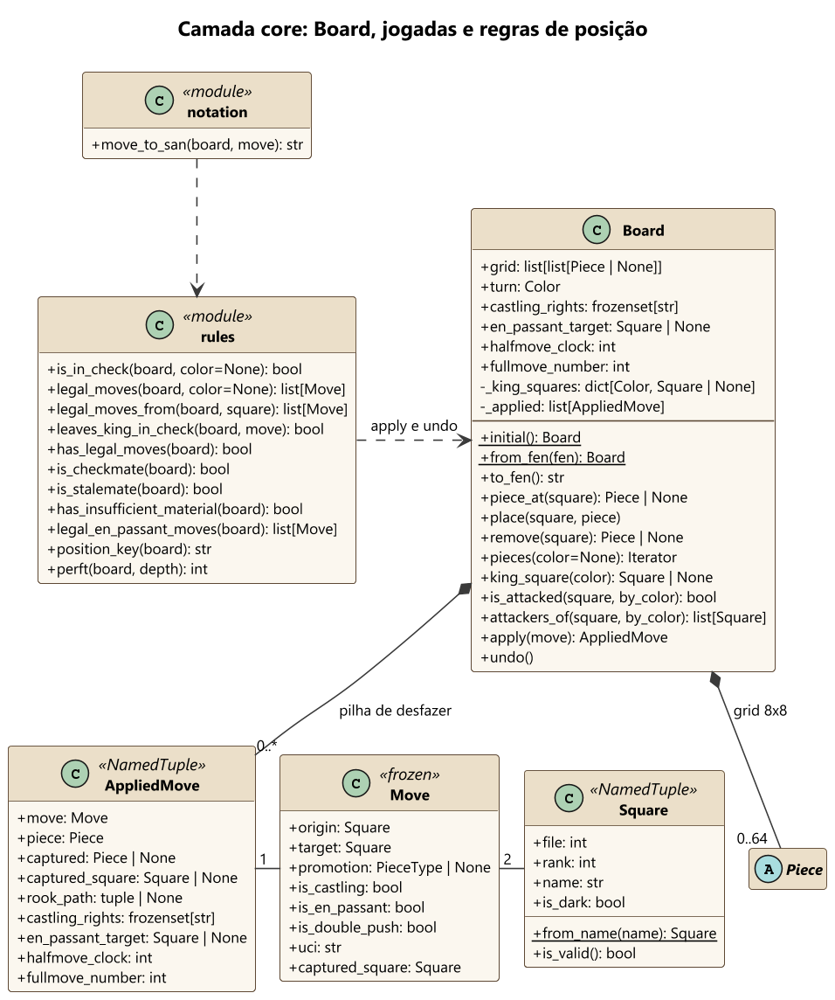

### Hierarquia de Piece

Cada peça conhece só o próprio padrão, em `attacks` e `pseudo_legal_moves`. `SlidingPiece` concentra a colisão de caminho de torre, bispo e dama. `King` acrescenta o roque e `Pawn` tem as regras próprias de avanço, captura, en passant e promoção. `rules.py` filtra as jogadas pseudolegais que deixam o rei em xeque, porque essa resposta é igual para todas as peças.

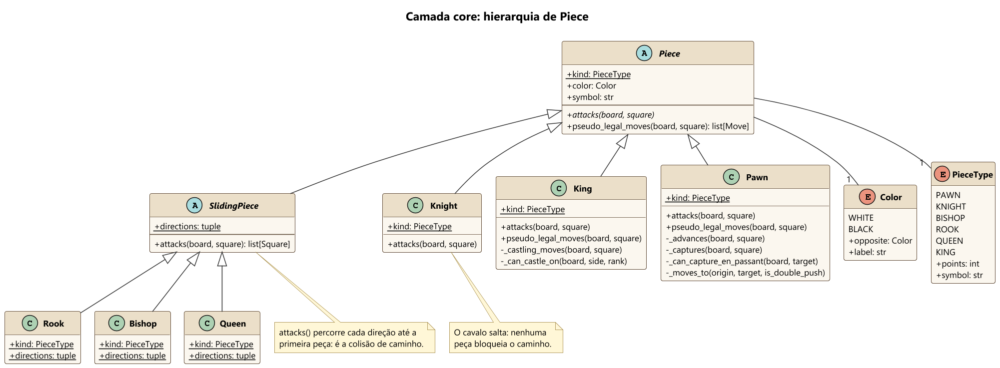

## 4.3 Camada graphics

### Pipeline de desenho

`Renderer3D` recebe a cena de um quadro por `add_mesh`, `add_marker` e `add_particles` e desenha tudo em `flush`. `Camera` tem as matrizes de visão e projeção e faz o caminho inverso, do pixel ao mundo. `matrix.py` reúne as funções que devolvem matrizes 4x4. `Mesh` guarda vértices e faces em arrays numpy. `ColorMatrix` transforma o estado de cada casa em cor.

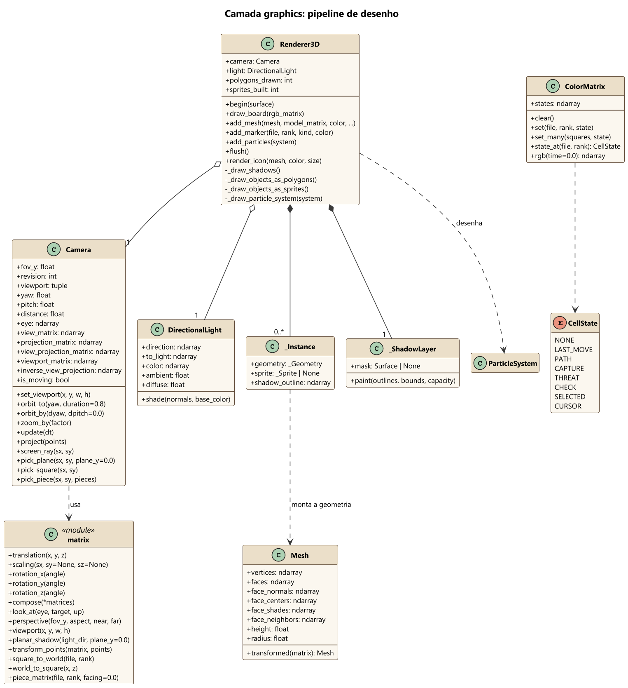

### Vetores, animações e partículas

As quatro animações herdam de `_TimedAnimation`, que tem um `Tween` para o progresso. Cada uma transforma o progresso em uma matriz-modelo. `Vector2D` é usado onde a leitura da matemática importa mais que a velocidade, como na direção da peça em voo. `ParticleSystem` guarda tudo em arrays, com uma linha por partícula, porque um laço de objetos Python custaria caro demais a cada quadro.

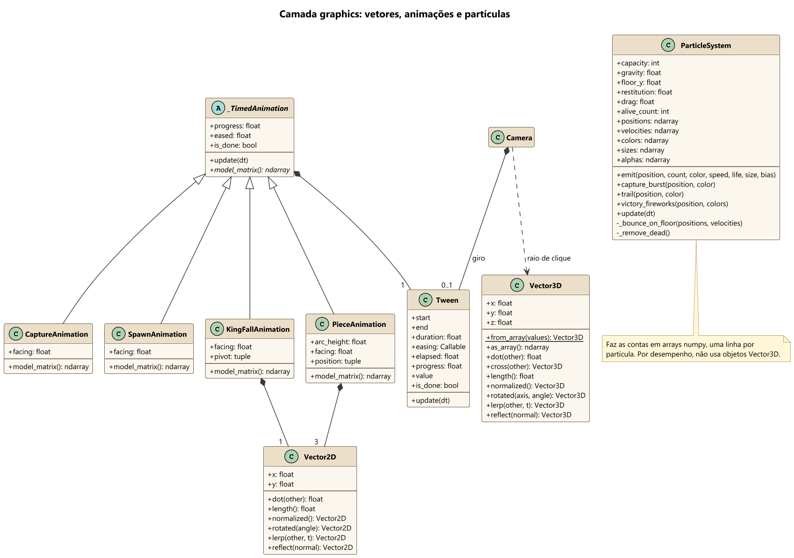

## 4.4 Camada ui

### Aplicação e cenas

`App` tem o laço principal e a cena atual. Para trocar de tela, a cena preenche `next_scene`, e o `App` faz a troca no fim do quadro. As cenas se chamam em ciclo, então são criadas pelos métodos do `App`, o que evita importação circular. O `BoardView` passa da `GameScene` para a `GameOverScene`: por isso é agregação. O tabuleiro continua no mesmo lugar na troca de tela.

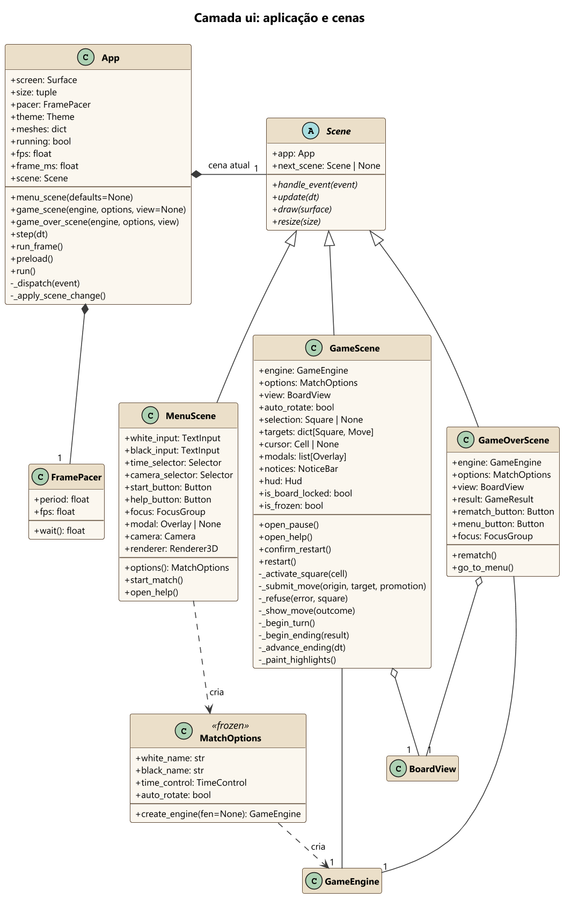

### Apresentação da partida e HUD

`BoardView` traduz os tipos do motor para os valores simples que `graphics` espera. Decidir o que destacar é da `GameScene`; aqui só se desenha. `Hud` é o painel lateral, e `NoticeBar` é a faixa de avisos. Os painéis das teclas F3 e F4 mostram as medidas e as contas ao vivo.

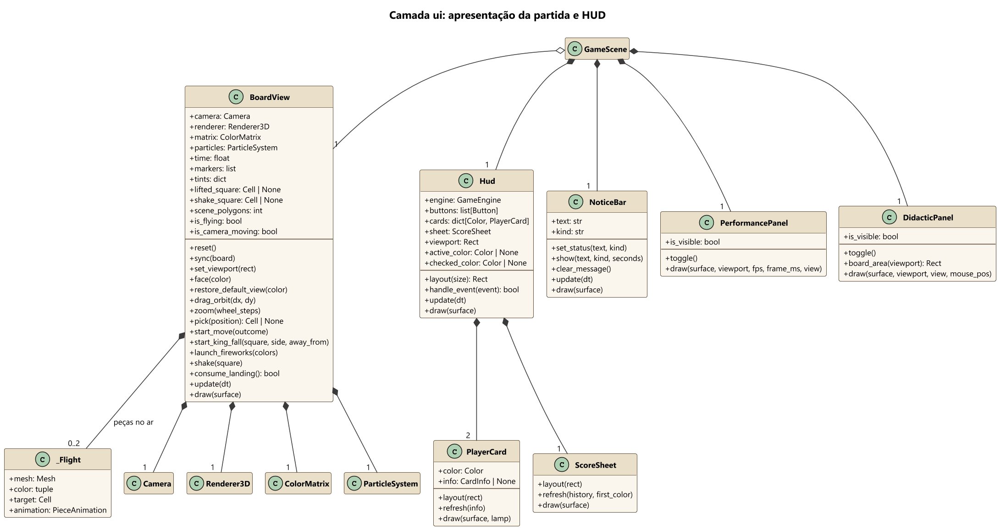

### Sobreposições e controles

As sobreposições ficam em uma pilha, e só a do topo recebe entrada. `freezes_clock` diz se o relógio para: a pausa congela, mas a promoção não, porque escolher a peça faz parte do lance. `FocusGroup` percorre os controles pelo teclado.

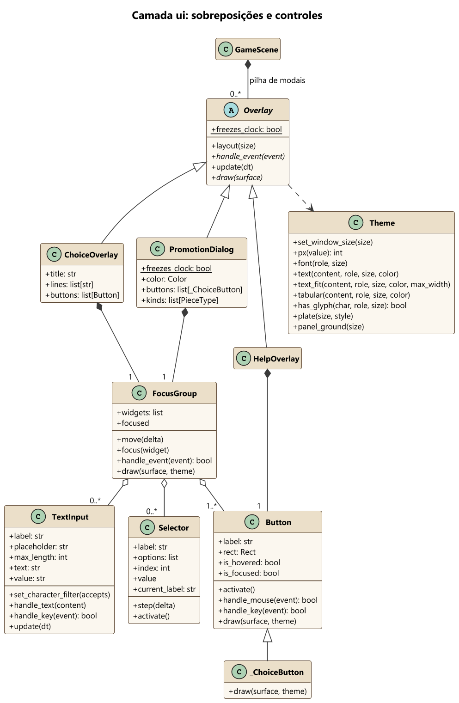

## 4.5 Sequência: movimento do jogador

Mostra o caminho de um clique até a jogada. Os blocos `alt` trazem os casos de exceção: tabuleiro travado, tentativa fora do turno, movimento inválido, jogada que expõe o rei e promoção sem escolha. Toda recusa volta ao jogador com a mensagem que veio do motor. A interface não decide regra.

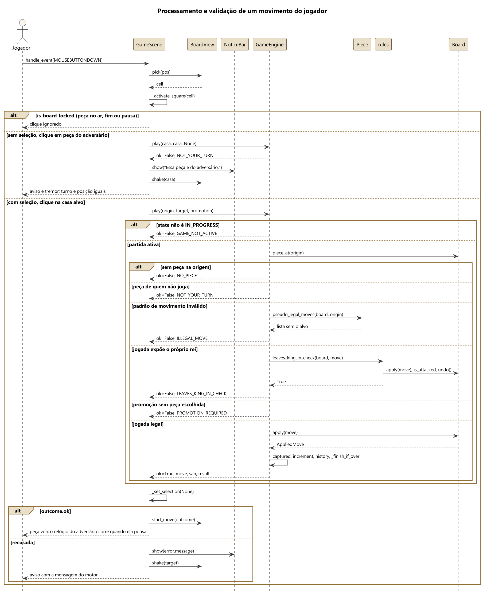

## 4.6 Sequência: fim de jogo

Dentro de `play`, depois de aplicar o lance, o motor verifica o fim nesta ordem: sem jogadas (mate ou afogamento), material insuficiente, tripla repetição e 50 lances. O mate vem primeiro de propósito: quem dá mate no lance que completaria os 50 lances vence a partida.

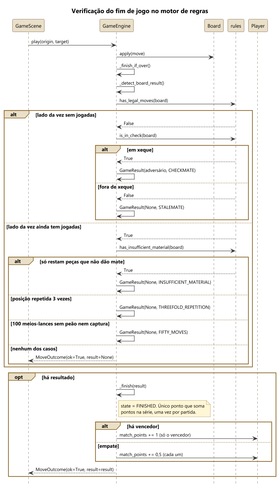

O motor já encerrou a partida, mas a interface espera a peça pousar. Então chama `_begin_ending`, tomba o rei e solta os fogos. A tela final recebe o mesmo `BoardView`, então os fogos continuam sem interrupção.

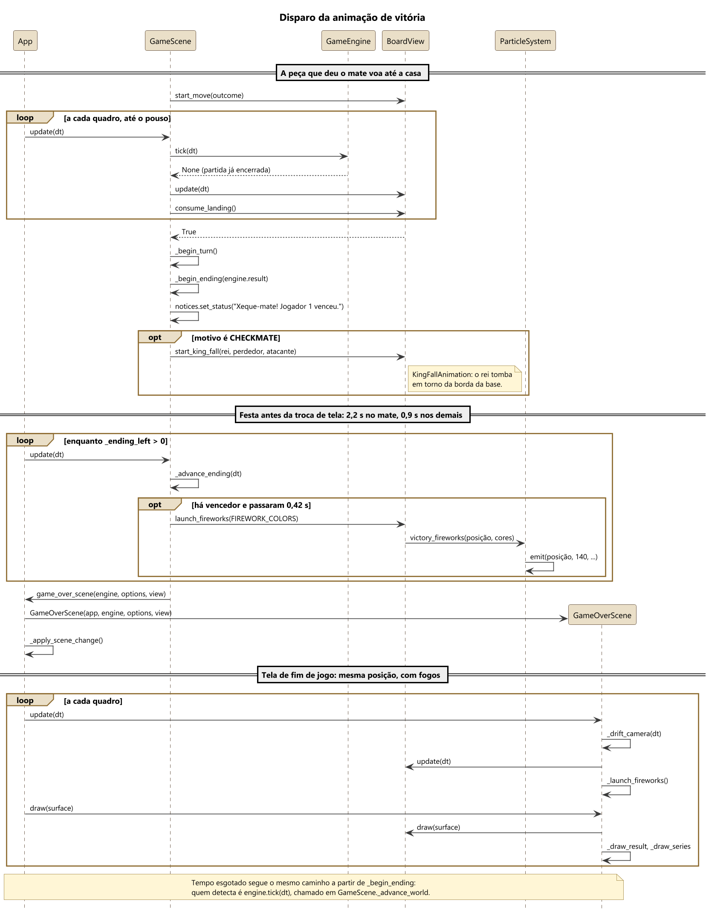

## 4.7 Sequência: do clique à casa

Este é o caminho inverso do pipeline gráfico. O pixel vira coordenada NDC, a inversa da view-projection devolve um raio no mundo, e o raio descarta as peças longe dele por um cilindro envolvente. As restantes são testadas pela silhueta projetada, da mais próxima para a mais distante. Se nenhuma aparece no pixel, vale o plano do tabuleiro. As fórmulas estão na seção 6.3.

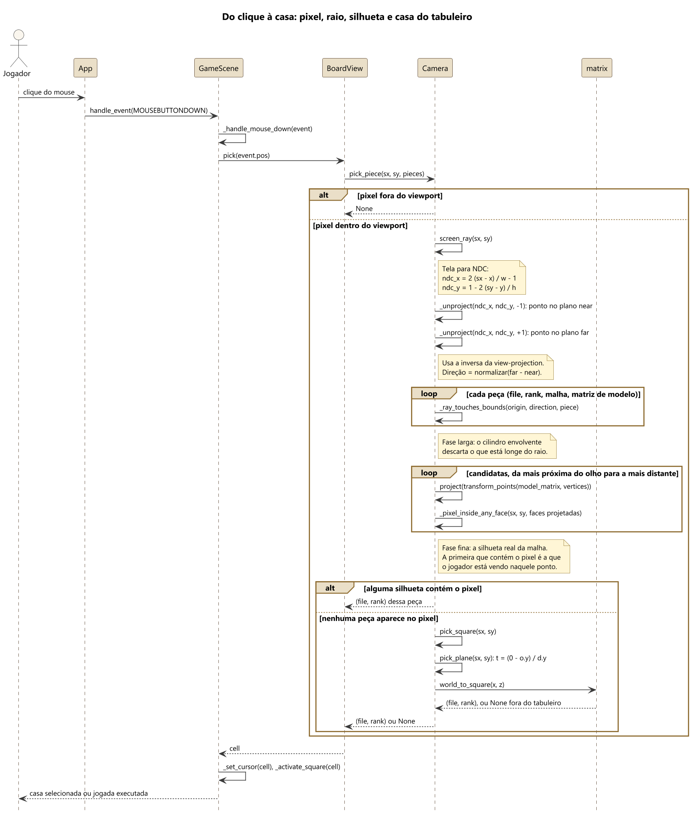

## 4.8 Estados

Estados do motor. Desistência e acordo valem também durante a pausa.

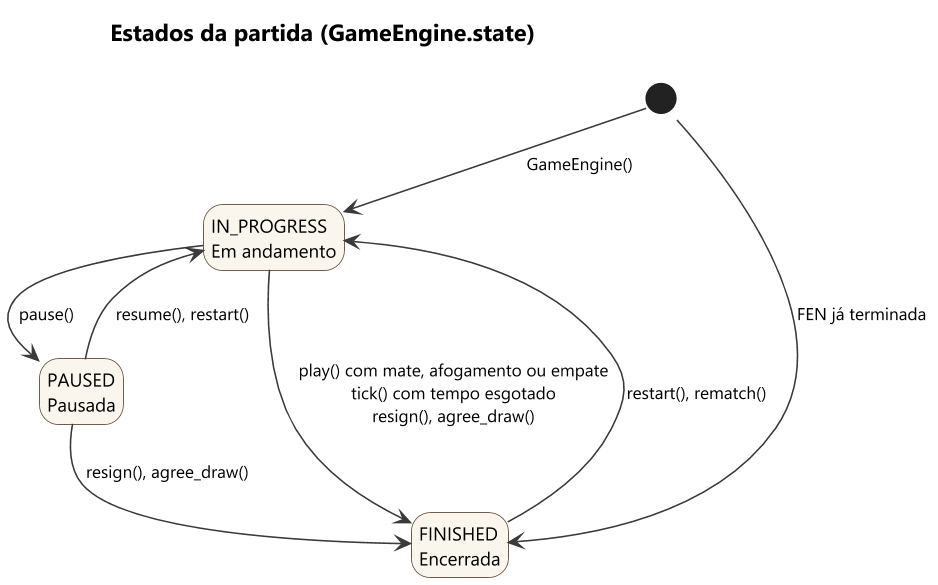

Fluxo entre as telas. Na revanche, o motor é o mesmo. Pelo menu, é criado um novo.

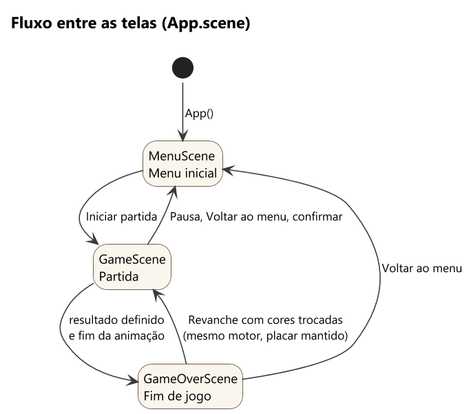
