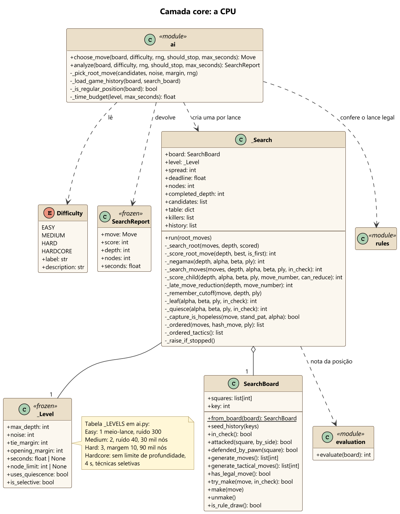
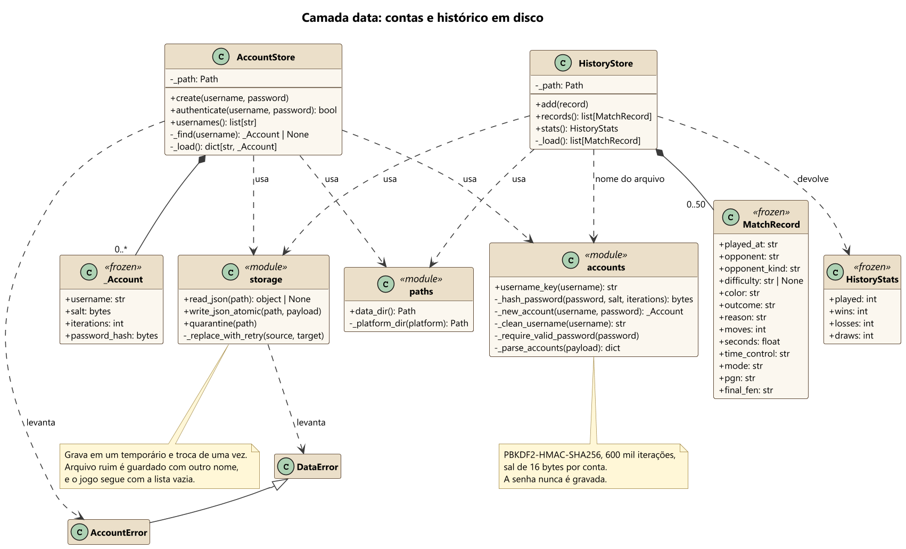
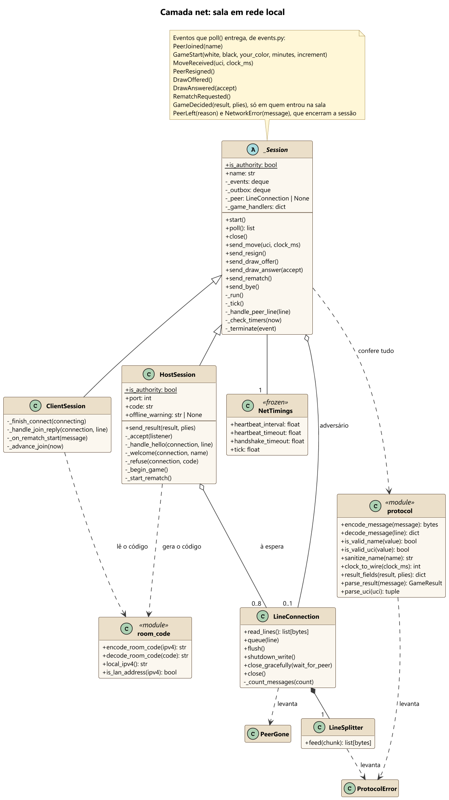
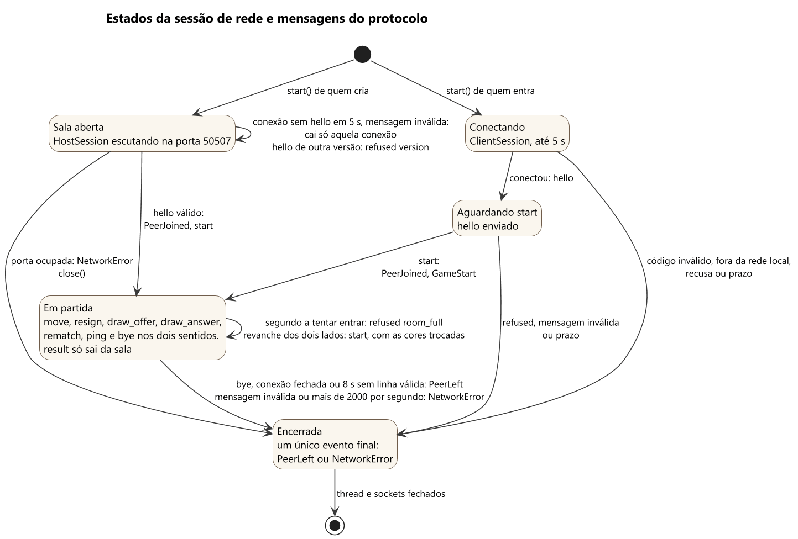
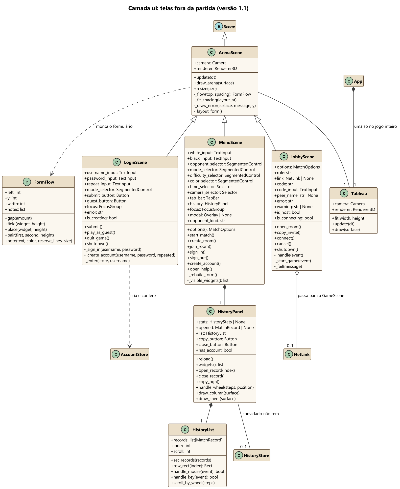
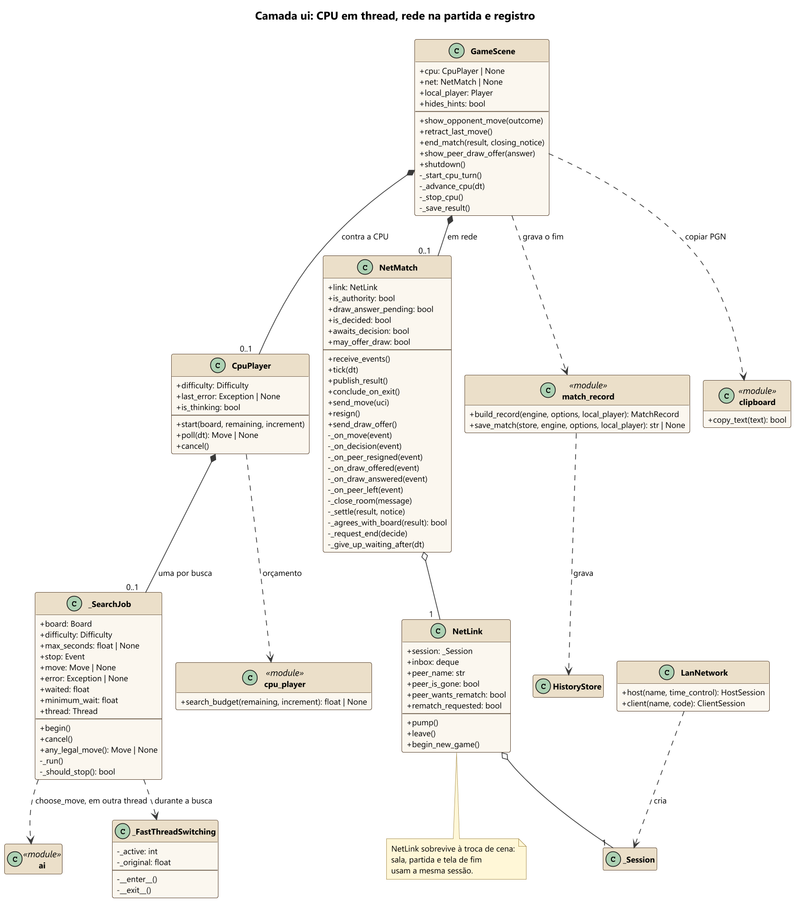
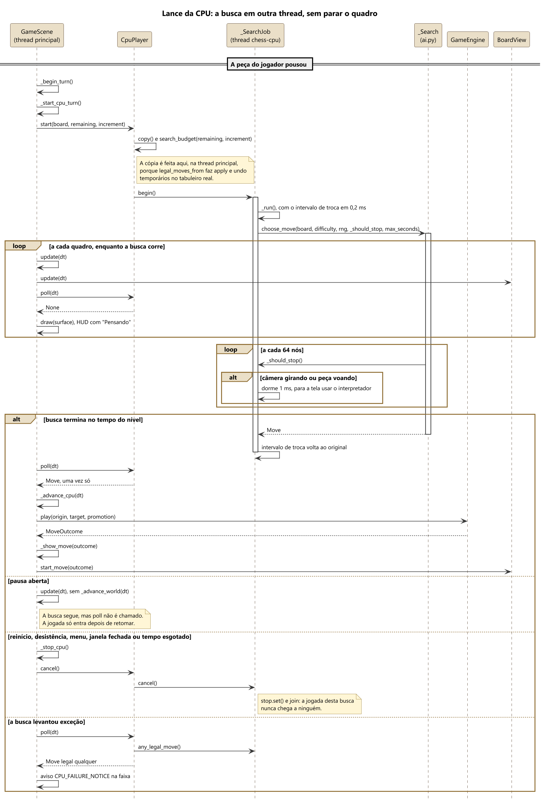
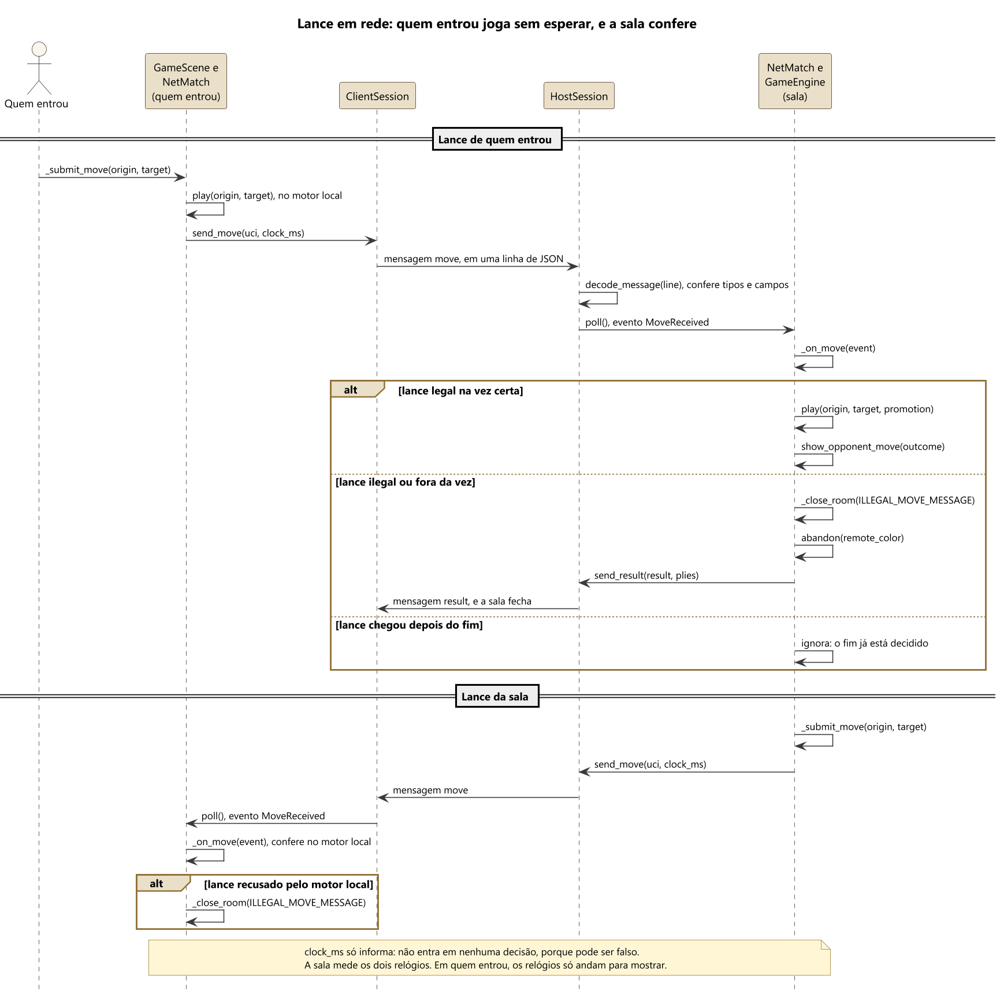
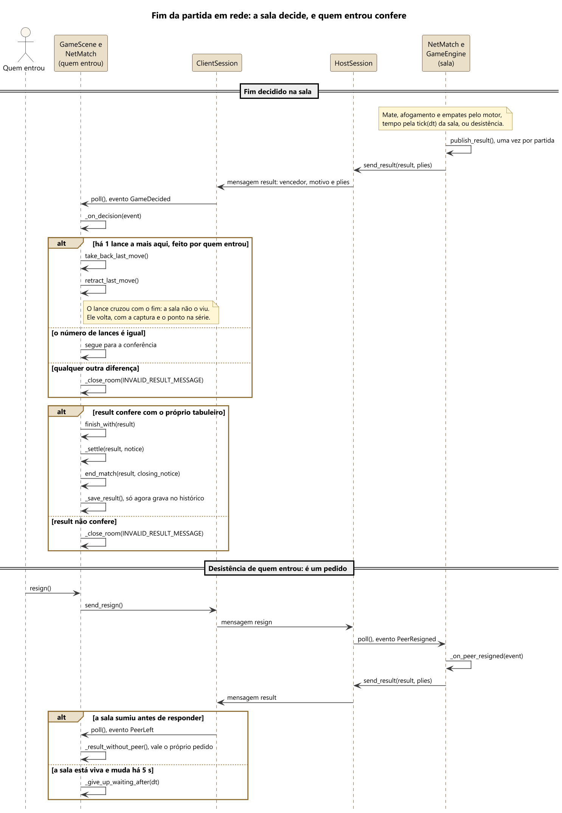

# 4. Modelagem UML

Os diagramas foram escritos em PlantUML. As fontes estão em `docs/uml/` e as imagens são geradas por `tools/gerar_uml.py`. Antes de desenhar, esse script lê o código com `ast` e confere se toda classe, atributo e método citado em um diagrama de classes existe em `xadrez/`, e se toda chamada citada em um diagrama de sequência existe também. Se o código mudar e o diagrama ficar para trás, a geração para com a lista do que divergiu.

**Como ler os diagramas de classes.**

- `+` é público e `-` é privado (nome com sublinhado no início, em Python).
- Sublinhado é membro de classe. Itálico é abstrato.
- Triângulo vazado é herança. Losango cheio é composição: o todo cria e controla a parte. Losango vazado é agregação: a parte vem de fora ou é compartilhada. Linha simples é associação. Seta tracejada é dependência.
- O número na ponta da linha é a multiplicidade.
- O círculo com letra no título é a marca do PlantUML para o tipo: C é classe, A é abstrata e E é enumeração.
- «module» marca um arquivo Python só de funções (`rules.py`, `notation.py`, `matrix.py`, `protocol.py`). Não é uma classe: aparece porque as classes dependem dele. «frozen» marca uma dataclass imutável, e «NamedTuple», uma tupla com nomes.
- Os membros privados de apoio foram omitidos quando não ajudam a entender a classe. Tudo o que aparece existe no código.

## 4.1 Visão geral

As seis classes pedidas no enunciado estão aqui: `GameEngine`, `Board`, `Piece`, `Player`, `Vector2D` e `ParticleSystem`. A `GameScene` é o ponto de ligação: conversa com o motor por um lado, com a apresentação 3D pelo outro, e, na versão 1.1, com a CPU, com a sala em rede e com o histórico. As camadas `core` e `graphics` não se conhecem. `data` e `net` também não: a regra está na seção 5.2.

## 4.2 Camada core

### GameEngine e colaboradores

`GameEngine` é a fachada que a interface usa. É dona do `Board`, dos 2 `Player` e do `ChessClock`. O método `play` nunca levanta exceção por causa de entrada inválida: devolve um `MoveOutcome`, com o erro em `MoveError` ou com o relatório da jogada. É esse relatório que a interface usa para animar.

A versão 1.1 acrescentou o que a sala em rede precisa: `abandon`, que dá a vitória ao outro lado; `finish_with`, que encerra com um resultado decidido fora dali; e `take_back_last_move`, que desfaz um lance que cruzou com o fim. `game_to_pgn` só lê a partida, e por isso fica em um módulo à parte, `pgn.py`.

### Board, jogadas e regras de posição

`Board` guarda a posição e executa o que recebe: não decide se a jogada é legal. Quem decide é `rules.py`, que aplica a jogada com `apply`, olha se o rei ficou atacado e desfaz com `undo`. A pilha de `AppliedMove` guarda o necessário para desfazer sem copiar o tabuleiro. `copy` existe para a CPU: a busca nunca toca o tabuleiro da partida.

`Piece` é composição de `Board` com multiplicidade 0..64 porque a grade tem 64 casas e o tabuleiro pode nascer vazio. Em uma partida real, são no máximo 32 peças.

### Hierarquia de Piece

Cada peça conhece só o próprio padrão, em `attacks` e `pseudo_legal_moves`. `SlidingPiece` concentra a colisão de caminho de torre, bispo e dama. `King` acrescenta o roque e `Pawn` tem as regras próprias de avanço, captura, en passant e promoção. `rules.py` filtra as jogadas pseudolegais que deixam o rei em xeque, porque essa resposta é igual para todas as peças.

### A CPU

`choose_move` é a porta de entrada, e `analyze` devolve também os números da busca, para as ferramentas. Cada lance cria um `_Search`, que faz negamax com poda alfa-beta sobre um `SearchBoard`: o mesmo xadrez de `Board`, mas com casas, peças e jogadas em inteiros, porque uma busca em Python puro não pode criar um objeto por posição. `_Level` é o que distingue os níveis, e a busca é a mesma para os quatro. As fórmulas e os motivos estão no capítulo 5.

## 4.3 Camada graphics

### Pipeline de desenho

`Renderer3D` recebe a cena de um quadro por `add_mesh`, `add_marker` e `add_particles` e desenha tudo em `flush`. `Camera` tem as matrizes de visão e projeção e faz o caminho inverso, do pixel ao mundo. `matrix.py` reúne as funções que devolvem matrizes 4x4. `Mesh` guarda vértices e faces em arrays numpy. `ColorMatrix` transforma o estado de cada casa em cor.

### Vetores, animações e partículas

As quatro animações herdam de `_TimedAnimation`, que tem um `Tween` para o progresso. Cada uma transforma o progresso em uma matriz-modelo. `Vector2D` é usado onde a leitura da matemática importa mais que a velocidade, como na direção da peça em voo. `ParticleSystem` guarda tudo em arrays, com uma linha por partícula, porque um laço de objetos Python custaria caro demais a cada quadro.

## 4.4 Camada data

`AccountStore` e `HistoryStore` só falam com o disco por `storage.py`, que grava em um temporário e troca de uma vez, e por `paths.py`, que diz onde fica a pasta de cada sistema. `AccountStore` não tem cache: duas cópias do jogo abertas no mesmo computador veem as contas uma da outra. O nome do arquivo de histórico é um hash do nome da conta, então nada digitado chega ao caminho.

## 4.5 Camada net

`_Session` tem o que a sala e quem entra nela têm em comum: a thread, as duas filas e a conversa depois do início da partida. `HostSession` escuta a porta, recebe o `hello` e decide o início. `ClientSession` conecta, manda o `hello` e espera o `start`. Só `HostSession` tem `send_result`, e só `ClientSession` recebe `GameDecided`. Tudo o que entra e sai passa por `protocol.py`. Os eventos são dataclasses simples, sem nenhuma referência a socket: é por eles que a interface sabe o que aconteceu.

Estados de uma sessão, com as mensagens que mudam cada um:

## 4.6 Camada ui

### Aplicação e cenas

`App` tem o laço principal e a cena atual. Para trocar de tela, a cena preenche `next_scene`, e o `App` faz a troca no fim do quadro. As cenas se chamam em ciclo, então são criadas pelos métodos do `App`, o que evita importação circular. O `BoardView` passa da `GameScene` para a `GameOverScene`: por isso é agregação. O tabuleiro continua no mesmo lugar na troca de tela. `hides_hints` é o modo Partida: um atributo só, que a cena consulta antes de pintar dicas e de calcular ameaças.

### Telas fora da partida

`ArenaScene` é a base do login, do menu e da sala: a mesa 3D à esquerda e o painel à direita. A mesa é o `Tableau`, um só no jogo inteiro, e por isso trocar de tela não faz a mesa pular. `FormFlow` empilha os controles de cima para baixo. O histórico é uma aba do menu, em `HistoryPanel`, e não uma cena: a lista fica no painel e a folha da partida fica sobre a mesa.

### CPU, rede e registro na partida

`CpuPlayer` roda a busca em um `_SearchJob` por lance, em uma thread. `poll`, a cada quadro, entrega a jogada uma vez. Como cada busca é um objeto próprio, a jogada de uma busca cancelada nunca chega a ninguém. `_FastThreadSwitching` conta as buscas vivas, porque uma busca cancelada pode terminar depois de a próxima começar. `NetMatch` liga a sessão à `GameScene`, e `NetLink` sobrevive à troca de cena: sala, partida e tela de fim usam a mesma sessão.

### Apresentação da partida e HUD

`BoardView` traduz os tipos do motor para os valores simples que `graphics` espera. Decidir o que destacar é da `GameScene`; aqui só se desenha. `Hud` é o painel lateral, e `NoticeBar` é a faixa de avisos. Os painéis das teclas F3 e F4 mostram as medidas e as contas ao vivo.

### Sobreposições e controles

As sobreposições ficam em uma pilha, e só a do topo recebe entrada. `freezes_clock` diz se o relógio para: a pausa congela, mas a promoção não, porque escolher a peça faz parte do lance. `blocks_game` diz se o jogo fica sem entrada: o `PeerOfferCard` não bloqueia, porque quem recebe uma proposta de empate continua jogando. `FocusGroup` percorre os controles pelo teclado. `SegmentedControl` é um `Selector` com todas as opções à vista, e `TabBar` é um `SegmentedControl` desenhado como abas.

## 4.7 Sequência: movimento do jogador

Mostra o caminho de um clique até a jogada. Os blocos `alt` trazem os casos de exceção: tabuleiro travado, tentativa fora do turno, movimento inválido, jogada que expõe o rei e promoção sem escolha. Toda recusa volta ao jogador com a mensagem que veio do motor. A interface não decide regra. A exceção é o modo Partida, em que `_refuse` troca a mensagem por "Lance inválido." e não faz a casa tremer: o motor continua decidindo do mesmo jeito.

## 4.8 Sequência: fim de jogo

Dentro de `play`, depois de aplicar o lance, o motor verifica o fim nesta ordem: sem jogadas (mate ou afogamento), material insuficiente, tripla repetição e 50 lances. O mate vem primeiro de propósito: quem dá mate no lance que completaria os 50 lances vence a partida.

O motor já encerrou a partida, mas a interface espera a peça pousar. Então chama `_begin_ending`, tomba o rei e solta os fogos. A tela final recebe o mesmo `BoardView`, então os fogos continuam sem interrupção.

## 4.9 Sequência: do clique à casa

Este é o caminho inverso do pipeline gráfico. O pixel vira coordenada NDC, a inversa da view-projection devolve um raio no mundo, e o raio descarta as peças longe dele por um cilindro envolvente. As restantes são testadas pela silhueta projetada, da mais próxima para a mais distante. Se nenhuma aparece no pixel, vale o plano do tabuleiro. As fórmulas estão na seção 6.3.

## 4.10 Sequência: lance da CPU

A cena copia o tabuleiro na thread principal e dispara a busca em outra thread. A cada quadro, `poll` só pergunta se a jogada chegou, e a resposta é "ainda não" sem esperar nada. A busca consulta `_should_stop` a cada 64 nós: se a câmera ou uma peça estão se mexendo, ela dorme 1 ms, porque naquele quadro a tela precisa mais do interpretador. A pausa não cancela nada: a busca segue, mas a jogada só entra depois de retomar. Reiniciar, desistir, sair e o tempo esgotado cancelam. Por que thread e não processo está na seção 5.5.

## 4.11 Sequência: lance e fim em rede

Quem entrou na sala joga sem esperar: o lance vale na hora, no motor local, e segue para a sala. A sala valida no próprio motor. Lance ilegal ou fora da vez encerra a partida, a favor de quem ficou.

O fim é só da sala. Ela manda `result`, com vencedor, motivo e em que lance a partida parou. Quem entrou compara com o que tem: se há um lance a mais, foi o dele, que cruzou com o fim, e esse lance volta. Depois, confere o resultado contra o próprio tabuleiro e só então abre a tela de fim e grava o histórico. Desistir e aceitar empate são pedidos: valem quando a sala responde, ou quando ela some. Os motivos estão na seção 5.5.

## 4.12 Estados

Estados do motor. Desistência e acordo valem também durante a pausa.

Fluxo entre as telas. Na revanche, o motor é o mesmo. Pelo menu, é criado um novo. `App()` abre direto no menu e é o que testes e ferramentas usam, sem contas e sem rede. O jogo do jogador é `App(require_login=True)`.

