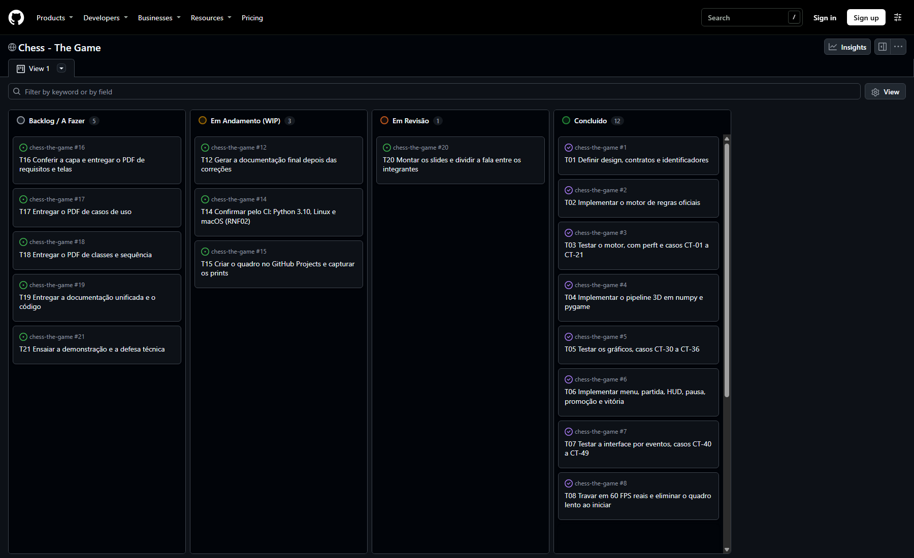
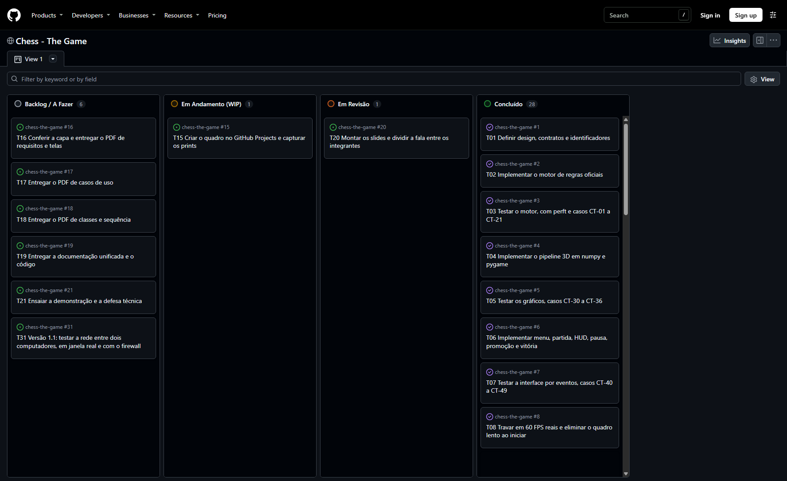

# 9. Gestão do projeto: Kanban

## 9.1 Situação real

O enunciado pede evidência de uso de metodologia ágil, com prints mostrando a evolução das tarefas ao longo do semestre. Este capítulo registra só o que aconteceu de fato.

- O histórico real do projeto começa em 2026-11-03, conforme o `git log` abaixo. Não existe histórico anterior a essa data.
- O quadro foi criado em 2026-11-04 no GitHub Projects, com o script `tools/preparar_github.py`: https://github.com/users/Kauhan33/projects/1. As tarefas que já estavam prontas nasceram na coluna "Concluído", e a issue de cada uma avisa que a data dela não é a data do trabalho.
- Portanto, o quadro só registra evolução real a partir dessa data. O projeto não tem prints anteriores a ela.
- Os próximos prints precisam ser capturados pelo grupo ao longo do uso, com `tools/capturar_kanban.py`. Eles não podem ser gerados depois, nem reconstruídos com datas passadas.
- As tarefas T22 em diante, da versão 1.1, estão só em `docs/kanban/tarefas.json`. Até a data deste documento, elas não foram levadas ao quadro do GitHub, porque a versão 1.1 ainda não foi publicada. O estado de cada uma é o verdadeiro em 2026-11-06, e a evidência é o commit ou a medição indicada.

## 9.2 Colunas e tarefas

As colunas são as pedidas no enunciado. A fonte das tarefas é `docs/kanban/tarefas.json`. O limite de WIP proposto para a coluna "Em Andamento (WIP)" é de 3 tarefas.

<!-- GERADO:kanban -->
| Coluna | ID | Tarefa | Marco | Evidência |
|---|---|---|---|---|
| Backlog / A Fazer | T16 | Conferir a capa e entregar o PDF de requisitos e telas | E1 | ainda não feita |
| Backlog / A Fazer | T17 | Entregar o PDF de casos de uso | E2 | ainda não feita |
| Backlog / A Fazer | T18 | Entregar o PDF de classes e sequência | E3 | ainda não feita |
| Backlog / A Fazer | T19 | Entregar a documentação unificada e o código | E4 | ainda não feita |
| Backlog / A Fazer | T21 | Ensaiar a demonstração e a defesa técnica | E5 | ainda não feita |
| Backlog / A Fazer | T31 | Versão 1.1: testar a rede entre dois computadores, em janela real e com o firewall | E5 | ainda não feita |
| Em Andamento (WIP) | T15 | Criar o quadro no GitHub Projects e capturar os prints | E4 | quadro criado em 2026-11-04; prints a capturar pelo grupo |
| Em Revisão | T20 | Montar os slides e dividir a fala entre os integrantes | E5 | slides prontos para o grupo revisar |
| Concluído | T01 | Definir design, contratos e identificadores | E4 | commit 714b188 |
| Concluído | T02 | Implementar o motor de regras oficiais | E4 | commit 411f20f |
| Concluído | T03 | Testar o motor, com perft e casos CT-01 a CT-21 | E4 | commit 411f20f |
| Concluído | T04 | Implementar o pipeline 3D em numpy e pygame | E4 | commit ed3143c |
| Concluído | T05 | Testar os gráficos, casos CT-30 a CT-36 | E4 | commit ed3143c |
| Concluído | T06 | Implementar menu, partida, HUD, pausa, promoção e vitória | E4 | commit 02e2248 |
| Concluído | T07 | Testar a interface por eventos, casos CT-40 a CT-49 | E4 | commit 02e2248 |
| Concluído | T08 | Travar em 60 FPS reais e eliminar o quadro lento ao iniciar | E4 | commit c5c150b |
| Concluído | T09 | Auditar o código e atacar o jogo (QA), casos CT-50 em diante | E4 | commit 86de291 |
| Concluído | T10 | Escrever requisitos, telas, UML, arquitetura, testes e PDF | E4 | commit 632c766 |
| Concluído | T11 | Aplicar as correções apontadas pelo QA | E4 | commit 86de291 |
| Concluído | T12 | Gerar a documentação final depois das correções | E4 | documentação gerada em 2026-11-04, com os resultados da seção 7.2 |
| Concluído | T13 | Publicar o repositório no GitHub, com autorização do grupo | E4 | commit 632c766, enviado em 2026-11-04 |
| Concluído | T14 | Confirmar pelo CI: Python 3.10, Linux e macOS (RNF02) | E4 | CI aprovado nas 6 combinações, commit bf74717 |
| Concluído | T22 | Versão 1.1: definir os contratos de modos, CPU, rede, contas e histórico | E4 | commit ff1e490 |
| Concluído | T23 | Versão 1.1: implementar contas, histórico e sala em rede local | E4 | commit a5b902b |
| Concluído | T24 | Versão 1.1: implementar a CPU em 4 níveis, o PGN e os tempos com incremento | E4 | commit dd124f8 |
| Concluído | T25 | Versão 1.1: implementar login, modos, CPU na tela, sala, histórico, arrasto e virada | E4 | commit 0671f69 |
| Concluído | T26 | Versão 1.1: auditar e atacar o jogo (QA), casos CT-100 a CT-135 | E4 | commit 032c696 |
| Concluído | T27 | Versão 1.1: corrigir os achados do QA, com quem cria a sala como autoridade | E4 | commit eaf8f25; QA11-17 aceito |
| Concluído | T28 | Versão 1.1: medir o FPS em janela real, com a CPU pensando (RNF09) | E4 | medido no commit eaf8f25, seção 7.9 |
| Concluído | T29 | Versão 1.1: levar requisitos, telas, UML, arquitetura, testes, roteiro e guia até a nova versão | E4 | commit 0021280 |
| Concluído | T30 | Versão 1.1: rodar a suíte completa e gerar os documentos e os PDFs finais | E4 | suíte completa em 2026-11-06, commit 0021280: 3655 aprovados, 0 falhas |
| Concluído | T32 | Versão 1.1: confirmar pelo CI em Python 3.10, Linux e macOS (RNF02) | E4 | CI aprovado nas 6 combinações, commit d14edf5 |
| Concluído | T33 | Versão 1.1: publicar no GitHub e gerar o novo executável, com autorização do grupo | E4 | release v1.1.0, commit d14edf5 |
| Concluído | T34 | Decidir se o modo de cada jogador deve aparecer para o outro em rede (sugestão 1 do QA) | E4 | decisão do aluno em 2026-11-06: um modo só, escolhido por quem cria a sala |
| Concluído | T35 | Versão 1.1.1: um modo só por sala em rede, com o protocolo 3 | E4 | suíte completa no commit 846bba7: 3668 aprovados, 0 falhas |
| Concluído | T36 | Versão 1.1.1: publicar no GitHub e gerar o novo executável, com autorização do grupo | E4 | release v1.1.1, commit 4be3181 |
<!-- FIM:kanban -->

## 9.3 Evolução real pelo git

Tabela gerada do `git log`, com as datas e as mensagens originais dos commits.

<!-- GERADO:evolucao -->
| Data e hora | Commit | Mensagem |
|---|---|---|
| 2026-11-03 20:26 | `714b188` | chore: estrutura inicial do projeto e documento de design |
| 2026-11-03 21:00 | `411f20f` | feat(core): motor de regras oficiais do xadrez |
| 2026-11-03 21:10 | `ed3143c` | feat(graphics): pipeline 3D low-poly proprio em numpy e pygame |
| 2026-11-04 01:55 | `02e2248` | feat(ui): menu, partida, HUD, pausa, promocao e tela de vitoria |
| 2026-11-04 01:56 | `c5c150b` | fix(ui): trava em 60 FPS reais e elimina o quadro lento ao iniciar a partida |
| 2026-11-04 14:09 | `86de291` | fix: corrige os defeitos provados pelo QA e acrescenta os testes de ataque |
| 2026-11-04 14:53 | `632c766` | docs: documentacao completa, UML, plano de testes e novo nome do jogo |
| 2026-11-04 15:29 | `bf74717` | fix(graphics): corrige as sombras que sumiam no macOS ARM |
| 2026-11-04 16:23 | `c12a989` | docs: documentacao final com a suite completa e o CI nas 6 combinacoes |
| 2026-11-04 16:45 | `b920c1e` | chore: versao 1.0.0 |
| 2026-11-04 16:48 | `e3a0cbc` | docs: aponta o README para o executavel na pagina de releases |
| 2026-11-04 22:37 | `ff1e490` | docs: contratos da versao 1.1 |
| 2026-11-05 06:32 | `a5b902b` | feat: contas com senha, historico de partidas e sala em rede local |
| 2026-11-05 07:15 | `dd124f8` | feat(core): CPU com 4 niveis, PGN e tempos com incremento |
| 2026-11-05 18:21 | `0671f69` | feat(ui): login, modos Treinamento e Partida, CPU, sala em rede e historico |
| 2026-11-05 19:56 | `032c696` | test: testes de ataque da versao 1.1, com os defeitos ainda abertos |
| 2026-11-06 00:45 | `eaf8f25` | fix: corrige os achados do QA da versao 1.1 |
| 2026-11-06 05:07 | `0021280` | docs: leva toda a documentacao ate a versao 1.1 |
| 2026-11-06 06:38 | `45b0e5e` | docs: resultados da execucao completa da versao 1.1 |
| 2026-11-06 07:24 | `3cd07ad` | test: torna dois testes independentes do sistema e da maquina |
| 2026-11-06 08:09 | `bd26419` | docs: registra a aprovacao da versao 1.1 no CI |
| 2026-11-06 08:52 | `d14edf5` | test: tira o arredondamento do teste do sinal de vida |
| 2026-11-06 09:31 | `0bcbc24` | docs: registra a release v1.1.0 e o print do quadro |
| 2026-11-06 10:03 | `846bba7` | feat(rede): um modo so para os dois, escolhido por quem cria a sala |
| 2026-11-06 11:37 | `4be3181` | docs: resultados da suite completa da versao 1.1.1 |
| 2026-11-06 13:24 | `e338b9f` | docs: registra a release v1.1.1 e o quadro atualizado |
<!-- FIM:evolucao -->

## 9.4 Prints do quadro

Os dois primeiros prints são reais: o do dia em que o quadro foi criado e o do dia em que a versão 1.1 foi publicada. Os demais são espaços reservados: o grupo deve substituir cada item pela imagem real, com a data real da captura.





| Momento | Situação |
|---|---|
| Quadro logo depois de criado | Capturado em 2026-11-04 |
| Tarefas de correção do QA em andamento | A capturar pelo grupo |
| Documentação em revisão | A capturar pelo grupo |
| Slides da apresentação em andamento | A capturar pelo grupo |
| Tarefas da versão 1.1 no quadro, depois de publicadas | Capturado em 2026-11-06 |
| Quadro antes da entrega final | A capturar pelo grupo |

Para capturar um print novo, com a data de hoje no nome do arquivo:

```
python tools/capturar_kanban.py
```
